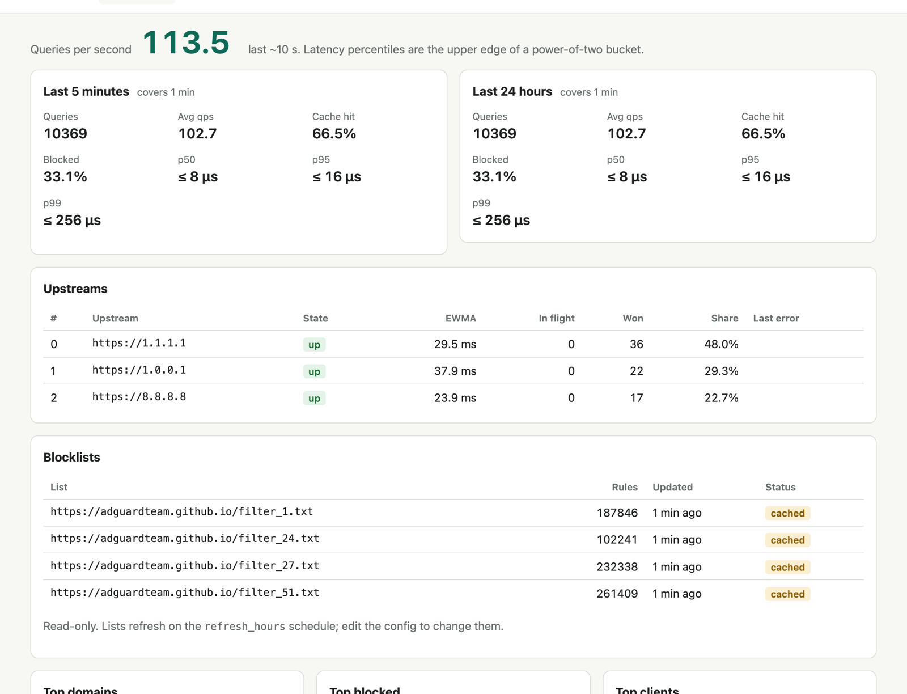

<div align="center">

# sopedu-dns

Network-wide ad blocking in one small binary.

Project page: [khalizov.com/sopedu](https://khalizov.com/sopedu/)

[](https://github.com/dkhalizov/sopedu-dns/actions/workflows/ci.yml)
[](https://github.com/dkhalizov/sopedu-dns/releases)
[](https://github.com/dkhalizov/sopedu-dns/pkgs/container/sopedu-dns)
[](https://crates.io/crates/sopedu-dns)
[](#license)
<br>
[](docs/conformance.md)
[](docs/bench/1.1.0.md)
[](docs/bench/1.1.0.md)
[](https://scorecard.dev/viewer/?uri=github.com/dkhalizov/sopedu-dns)



</div>

Every device on your network asks DNS for names: phones, laptops, the TV,
and the smart plug that keeps phoning home. sopedu-dns answers them. Ads and
trackers get an answer that says the name doesn't exist, popular names come
straight from the cache, and the rest goes out over encrypted
DNS-over-HTTPS, so your ISP sees less of what you do.

It's built for x86_64 and aarch64 Linux, so it fits a mini PC, a 64-bit
Raspberry Pi, a Docker host or a small Kubernetes cluster. There's no
database to look after. Binding port 53 needs root or the
`CAP_NET_BIND_SERVICE` capability; the container setups run it as root with
every other capability dropped.

## Why sopedu-dns

In the benchmark it held about 19 MiB of process memory with half a million
blocking rules loaded, and answered a median of 104k queries per second
(102k to 104k across three runs) on one CPU core of a shared, busy node.

It passed all 259 generic RFC MUST checks our harness could run against it,
and the comparison below runs the same checks on five other servers. Where
it departs from an RFC on purpose, for example DNSSEC handling in the
default mode, [docs/conformance.md](docs/conformance.md) says so, and the
[RFC evidence site](https://khalizov.com/sopedu/rfc/) shows each rule with
the test behind it.

Queries leave over DNS-over-HTTPS, to Cloudflare and Google by default or to
the providers you choose, so your ISP can't read them. Out of the box it
refuses clients outside loopback and private address ranges; a LAN with
global IPv6 addresses needs its /64 added
([IPv6 renumbering](docs/configuration.md#ipv6-renumbering)).

Every queue and table has a size limit, the parsers are fuzzed, and the
container image has no shell. A blocklist download with under a tenth of
the previous rules is held back for one refresh interval, so a broken
mirror doesn't empty your blocking overnight.

The dashboard shows the query rate, cache hit rate, upstream health and top
domains, the query log has a live tail, and the rule tester tells you which
list and which line blocked a name.

## How it compares

Performance was measured on sopedu-dns 1.1.0 on 10 November 2026. Each server
ran on one CPU core of the same machine, with the same mock upstream, the
same query stream and, for the blocking servers, the same four public lists.
Every server ran with its query log off; Numa ran with its defaults apart
from its proxy, DoT, mobile API and LAN discovery. sopedu-dns and Pi-hole were
measured about 90 minutes after the others, on a node that kept its usual
workload.

| Server | UDP queries per second, median of 3 (min-max) | Cache-hit p99 at 5k qps ¹ | Peak process memory |
|---|---|---|---|
| sopedu-dns 1.1.0 | 103.9k (101.6-104.0k) | 0.75 ms (0.70-3.52) | 18.9 MiB |
| Unbound 1.26.2 ² | 94.0k (87.2-94.6k) | 2.37 ms (0.70-5.38) | 26.4 MiB |
| Numa 0.25.0 | 44.6k (33.1-44.9k) | 1.02 ms (0.72-3.46) | 83.5 MiB |
| dnsmasq 2.91 ² | 24.0k (22.7-26.9k) | 16.4 ms | 10.2 MiB |
| Blocky v0.35.0 | 16.9k (16.8-17.0k) | 1.09 ms | 86.2 MiB |
| Pi-hole 2026.10.1 | 4.9k (4.3-5.0k) | 69.6 ms ³ | 146.9 MiB |
| AdGuard Home v0.107.79 | stopped answering ⁴ | 44.0 ms ³ | 509.4 MiB ⁴ |

¹ Median of five passes (min-max) for the three fastest servers, one pass for
the others.
² No blocklists loaded: plain forwarders, shown for reference.
³ Dropped queries at this rate: 3,536 (Pi-hole) and 913 (AdGuard Home) of 75,000.
⁴ 5.4k qps in the first run, then nothing; it reached its 512 MiB limit.

Out of the box sopedu-dns keeps a query log, which some of these servers
don't have. With it on, it measured a median of 91.9k queries per second
(73.4k to 101.4k over nine runs), a cache-hit p99 of 1.8 ms (0.9 to 3.8 ms
over five passes) and 18.6 MiB.

The benchmark states an ordering only when the three-run ranges don't
overlap and a bootstrap confidence interval of the median ratio agrees. By
that rule sopedu-dns was faster than Numa (2.3 times), Blocky (6.2 times) and
Pi-hole (21 times on the whole stream, 1.95 times on pure cache hits), and
AdGuard Home stopped answering. Against Unbound it was about 10% faster on the
whole stream, with its lists loaded against none; on unblocked names and pure
cache hits the ranges overlap, so there's no ranking there. In this setup
dnsmasq and Pi-hole forward HTTPS records, a quarter of the stream, on every
query, and that explains most of their whole-stream gap. dnsmasq 2.90 and
later can cache them with `--cache-rr`, which the bench doesn't set. On pure
cache hits the ranges of sopedu-dns and dnsmasq overlap.

Other servers come out ahead on some measurements. Unbound measured higher
over TCP in one run each (64.3k against 63.2k), dnsmasq and Blocky had a
lower cache-miss p99 in their single pass (15.1 against 16.4 ms), and dnsmasq
uses less memory. At 50 and 500 cache hits a second, Unbound and Blocky had
the lower p99 in their single passes, and Numa did too at 50. At 5k the
ranges of sopedu-dns, Numa and Unbound overlap, so none of the three is
ranked. The query stream was 12,692 real names from a home network, so you
can't replay it exactly, but the benchmark scripts take any list of names.

RFC conformance was compared on sopedu-dns 1.1.0 on 10 November 2026. Each
row counts the MUST checks for features both servers implement and the
harness could configure on both:

| Server | Version | MUST checks | Passed by it | Passed by sopedu-dns |
|---|---|---:|---:|---:|
| dnsmasq | 2.91 | 220 | 220 | 220 |
| AdGuard Home | v0.107.80 | 250 | 243 | 250 |
| Pi-hole | 2026.10.1 (FTL v6.8) | 220 | 217 | 220 |
| Unbound | 1.26.2 | 195 | 190 | 195 |
| Numa ¹ | 0.25.0 | 175 | 172 | 175 |

¹ Numa lowercases the question in its replies, which stops the harness's
exchange early. Its row comes from a second run that skipped only that
assertion.

The full benchmark is in [docs/bench/1.1.0.md](docs/bench/1.1.0.md), and the
method is in [bench/competitors/README.md](bench/competitors/README.md). The
conformance harness is ours and unpublished, written from our reading of the
RFCs; its method and limits are in [docs/conformance.md](docs/conformance.md).

## What it does

- Blocks with hosts files and adblock-style lists (`||ads.example^`, `@@`
  exceptions, `$important`), including trackers hidden behind CNAME chains.
  Lists refresh on a schedule and are kept on disk.
- Spreads queries over several DoH providers. When one is slow, the next
  starts after 50 ms and the first answer wins. Health checks and circuit
  breakers bench a failing provider. You can also keep every query with one
  provider and use the others as backup.
- Caches answers, serves stale ones when the upstream is down, refreshes
  popular names before they expire, and starts warm after a restart.
- Answers local names: rewrites with wildcards, `home.arpa` and private
  reverse zones. Chosen devices can skip filtering.
- Reloads its config on SIGHUP or when the file changes, after checking it.
  Exposes `/healthz`, Prometheus `/metrics` and structured logs.

## Quick start

Save a config as `config.toml`:

```toml
listen = "0.0.0.0:53"
state_dir = "/var/lib/sopedu-dns"
blocklists = ["https://adguardteam.github.io/HostlistsRegistry/assets/filter_1.txt"]
ui_enabled = true
```

Then start it with Docker on Linux:

```sh
docker run -d --name sopedu-dns --restart unless-stopped --network host \
  --user 0 --cap-drop ALL --cap-add NET_BIND_SERVICE --read-only \
  -v "$PWD/config.toml:/etc/sopedu-dns/config.toml:ro" \
  -v sopedu-state:/var/lib/sopedu-dns ghcr.io/dkhalizov/sopedu-dns:latest
```

If it can't bind port 53, another resolver such as `systemd-resolved` owns
it; see [When it will not start](docs/configuration.md#when-it-will-not-start).
Once the first list has downloaded, usually within seconds,
`dig @127.0.0.1 doubleclick.net` answers NXDOMAIN. Then point
your router's DHCP DNS setting at the host. Don't add a public
resolver as a second DNS server: plenty of devices will use it and skip
your blocking.

Other ways to run it:

- Static Linux binaries (x86_64 and aarch64) with checksums and signed
  build provenance are on the
  [releases page](https://github.com/dkhalizov/sopedu-dns/releases).
- [Docker Compose and publishing ports](docs/configuration.md#docker)
- [Kubernetes](docs/configuration.md#kubernetes): two replicas, one per node
- From source: `cargo install --locked sopedu-dns`

The dashboard listens on `127.0.0.1:9999` and has no login, so keep it on
loopback and reach it with `ssh -L 9999:127.0.0.1:9999 <host>`.

## What it leaves out

sopedu-dns doesn't recurse, validate DNSSEC (it passes
DNSSEC records through to clients that do), serve DoH or DoT to clients, or
hand out DHCP leases. The web UI is read-only: the config file is the
source of truth. If you want an all-in-one network tool, Pi-hole and
AdGuard Home are a better fit.

## How it was built

AI coding agents wrote the code. I chose the design, reviewed the changes
and decided how to check the result: the RFC conformance harness, fuzzing,
property tests, benchmarks against other servers, and reviews by separate
model instances that saw only the code and the RFCs. It has been my home
DNS since 3 November 2026.

The name comes from Sopedu (also Sopdu), the Egyptian god of the sky and
the eastern borders, who guarded Egypt's frontier outposts.

## Docs

[Configuration](docs/configuration.md) ·
[Behaviour spec](docs/specs/dns-forwarder.md) ·
[RFC conformance](docs/conformance.md) ·
[Benchmarks](docs/bench/) ·
[Security](SECURITY.md) ·
[Contributing](CONTRIBUTING.md) ·
[Changelog](CHANGELOG.md)

## License

Dual-licensed under [MIT](LICENSE-MIT) or [Apache-2.0](LICENSE-APACHE), at
your option.

Blocklists are downloaded at run time and aren't part of this repository;
each has its own license. AdGuard Home, Pi-hole, Blocky, Unbound, dnsmasq
and other product names are trademarks of their owners. sopedu-dns isn't
affiliated with any of them; see [THIRD_PARTY.md](THIRD_PARTY.md).
